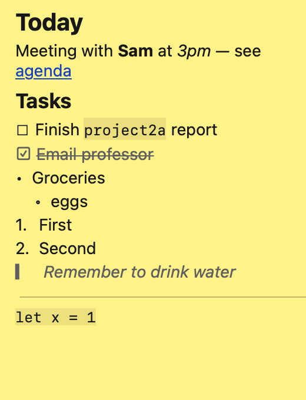

# DeskNotes

**Markdown sticky notes for your Mac desktop — editable by you *and* by your AI agent.**

Every note is just a Markdown file in `~/DesktopNotes/`. Type into a note on your desktop and the file is saved. Have Gemini, Claude, ChatGPT, a script or a cron job edit the file, and the note on your screen updates within a second.

<p align="center"></p>

## Features

- 🗒️ **Sticky notes on your desktop** — pinned behind your windows (or float them on top), on every Space.
- ✍️ **Rendered Markdown** — headings, **bold**, *italic*, `code`, links, lists, quotes, code blocks.
- ☑️ **Clickable checkboxes** — `- [ ]` tasks tick on click and save straight to the file.
- 🤖 **Agent-friendly** — notes are plain files, so any AI agent or script can read and update them live.
- 💾 **Nothing to lose** — closing a note archives it to `~/DesktopNotes/.archive` instead of deleting it.
- 🪶 **Tiny & native** — a single Swift file, no dependencies, no Dock icon, just a menu bar item.

## Install

Requires **macOS 13 Ventura or later**.

### Option A — Download the app

1. Download `DeskNotes.zip` from the [latest release](https://github.com/JacksonHoran/DeskNotes/releases/latest) and unzip it.
2. Move `DeskNotes.app` to your `Applications` folder.
3. The app isn't notarized by Apple, so the first time you open it, **right-click → Open → Open**.
   (Or run `xattr -dr com.apple.quarantine /Applications/DeskNotes.app` in Terminal.)

### Option B — Build from source

Needs the Xcode Command Line Tools (`xcode-select --install`).

```bash
git clone https://github.com/JacksonHoran/DeskNotes.git
cd DeskNotes
./build.sh install
```

This builds the app, copies it to `~/Applications` and launches it. Use `./build.sh` to only build, or `./build.sh release` to make a zip for distribution.

## Using it

Look for the note icon in your menu bar. A "Today" note is created on first launch.

| To… | Do this |
|---|---|
| Edit a note | Click it — it switches to raw Markdown |
| Go back to the preview | Press **Esc** or click outside the note (or **⌘E** to toggle) |
| Tick a checkbox | Click ☐ / ☑ in the preview |
| New note | Menu bar icon → **New Note** (or **⌘N** while a note is focused) |
| Close / archive a note | The note's close button (or **⌘W**) |
| Move / resize | Drag the top edge / the corners — positions are remembered |
| Float notes above windows | Menu bar → uncheck **Pin to Desktop** |
| Start at login | Menu bar → **Open at Login** |
| See all files | Menu bar → **Open Notes Folder** |

**Tip:** while pinned to the desktop, notes sit behind your windows. Use *Show Desktop* (F11, or a trackpad spread) to reach them, or choose **Bring Notes to Front** from the menu bar.

### Supported Markdown

`#` headings · `**bold**` · `*italic*` · `~~strike~~` · `` `code` `` · `[links](https://…)` · `- bullets` (indent 2 spaces to nest) · `1. numbered` · `- [ ]` / `- [x]` checkboxes · `> quotes` · `---` dividers · fenced code blocks.
Tables and images aren't rendered.

## Using it with an AI agent

Because each note is a file, any agent that can read and write files can manage your notes. There's no API or plugin to set up.

```
~/DesktopNotes/
├── Today.md          ← a note titled "Today"
├── Groceries.md      ← a note titled "Groceries"
├── GEMINI.md         ← instructions for agents (not shown as a note)
├── AGENTS.md         ← same, for other agents (not shown as a note)
├── .layout.json      ← window positions
└── .archive/         ← closed notes
```

- **Gemini CLI**: run `gemini` from `~/DesktopNotes` and it picks up the generated `GEMINI.md` automatically. To make it aware of your notes from anywhere, paste [`docs/AGENT_PROMPT.md`](docs/AGENT_PROMPT.md) into `~/.gemini/GEMINI.md`.
- **Claude Code, Codex, other agents**: point them at `~/DesktopNotes/AGENTS.md`, or paste [`docs/AGENT_PROMPT.md`](docs/AGENT_PROMPT.md) into their system prompt or instructions file.
- **Scripts**: `echo "- [ ] Call the dentist" >> ~/DesktopNotes/Today.md` works too.

The app saves your typing about 0.4 s after you stop, and it ignores changes from outside while you're mid-edit. Agents should still re-read a file right before changing it and make small, targeted edits. The prompt in `docs/` tells them this.

## How it works

DeskNotes is under 600 lines of Swift/AppKit in [`Sources/main.swift`](Sources/main.swift):

- Every second it polls `~/DesktopNotes` and opens, closes or reloads note windows to match the files.
- Each note is a window with a transparent title bar at desktop-icon level (or floating level), with two views: a rendered Markdown preview and a plain-text editor.
- Markdown block syntax (headings, lists, checkboxes…) is parsed line by line; inline syntax uses Apple's `AttributedString(markdown:)`.

## Uninstall

Quit from the menu bar, then delete `DeskNotes.app`. Your notes stay in `~/DesktopNotes` until you delete that folder too.

## License

[MIT](LICENSE) © Jackson Horan
